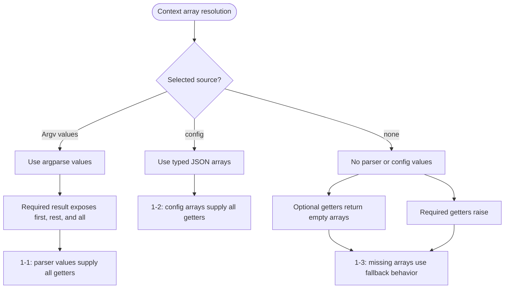
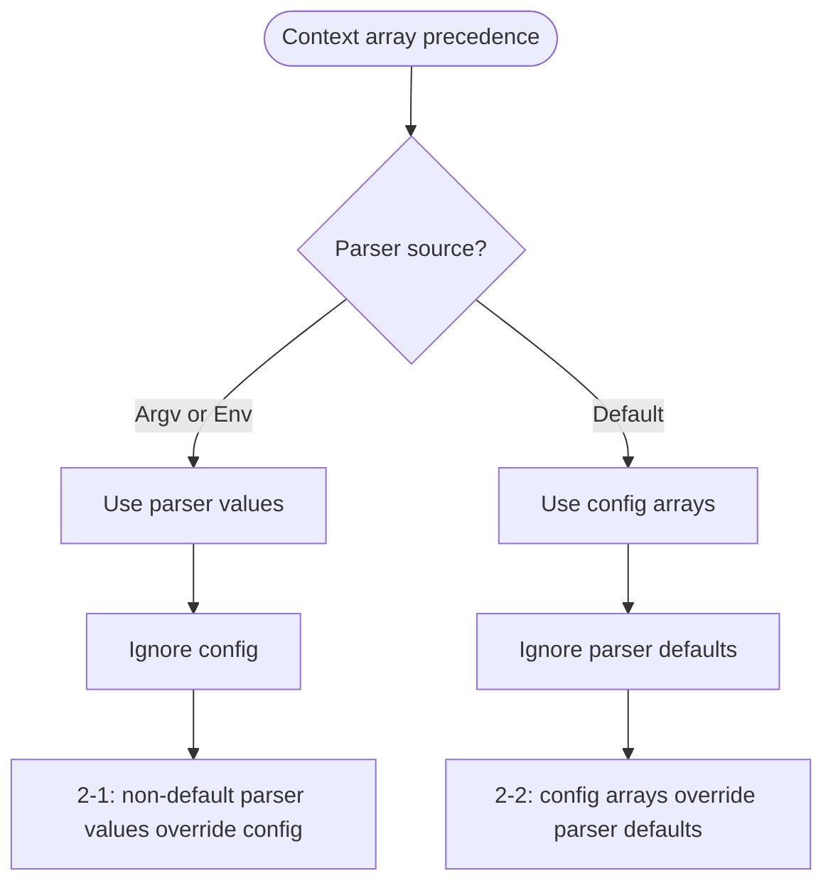
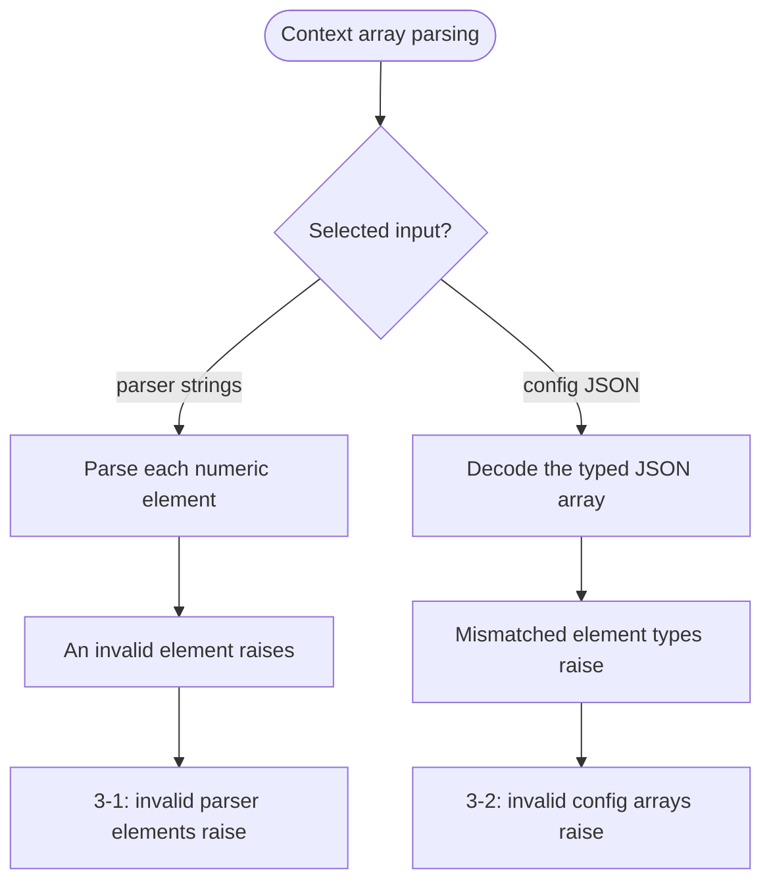

# context_arrays.mbt

`Context` resolves repeated argument values as arrays, returns empty arrays for unavailable optional values, preserves element parsing failures, and represents required values as `NonEmptyArray`.

## Public API

- `@admiral.Context::get_strings`
- `@admiral.Context::get_strings_required`
- `@admiral.Context::get_ints`
- `@admiral.Context::get_ints_required`
- `@admiral.Context::get_int64s`
- `@admiral.Context::get_int64s_required`
- `@admiral.Context::get_uints`
- `@admiral.Context::get_uints_required`
- `@admiral.Context::get_uint64s`
- `@admiral.Context::get_uint64s_required`
- `@admiral.Context::get_doubles`
- `@admiral.Context::get_doubles_required`

## Test

The array getters intentionally share branch-oriented test cases because they implement the same resolution flow for different element types. Each numbered case invokes every applicable getter in the family. `ValueSource` is read-only, so parser-value fixtures obtain `sources` from argparse.

### Array resolution

#### Source-specific resolution



#### Precedence



#### Parsing



```mbt check
///|
test "Context array resolution 1-1 - parser values supply all getters" {
  let matches = @argparse.Command("test", options=[
    @argparse.OptionArg("values", action=@argparse.OptionAction::Append),
  ]).parse(argv=["--values", "1", "--values", "2"], env=Map([]))
  let ctx = @admiral.Context::Context(
    values=matches.values,
    sources=matches.sources,
  )
  let string_values = @admiral.strings("values", required=true)
  let int_values = @admiral.ints("values", required=true)
  let int64_values = @admiral.int64s("values", required=true)
  let uint_values = @admiral.uints("values", required=true)
  let uint64_values = @admiral.uint64s("values", required=true)
  let double_values = @admiral.doubles("values", required=true)
  debug_inspect(
    ctx.get_strings(string_values),
    content=(
      #|<ReadOnlyArray: ["1", "2"]>
    ),
  )
  debug_inspect(
    ctx.get_ints(int_values),
    content=(
      #|<ReadOnlyArray: [1, 2]>
    ),
  )
  debug_inspect(
    ctx.get_int64s(int64_values),
    content=(
      #|<ReadOnlyArray: [1, 2]>
    ),
  )
  debug_inspect(
    ctx.get_uints(uint_values),
    content=(
      #|<ReadOnlyArray: [1, 2]>
    ),
  )
  debug_inspect(
    ctx.get_uint64s(uint64_values),
    content=(
      #|<ReadOnlyArray: [1, 2]>
    ),
  )
  debug_inspect(
    ctx.get_doubles(double_values),
    content=(
      #|<ReadOnlyArray: [1, 2]>
    ),
  )
  debug_inspect(
    ctx.get_strings_required(string_values),
    content=(
      #|{
      #|  first: "1",
      #|  rest: <ArrayView: ["2"]>,
      #|  all: <ReadOnlyArray: ["1", "2"]>,
      #|}
    ),
  )
  debug_inspect(
    ctx.get_ints_required(int_values),
    content=(
      #|{ first: 1, rest: <ArrayView: [2]>, all: <ReadOnlyArray: [1, 2]> }
    ),
  )
  debug_inspect(
    ctx.get_int64s_required(int64_values),
    content=(
      #|{ first: 1, rest: <ArrayView: [2]>, all: <ReadOnlyArray: [1, 2]> }
    ),
  )
  debug_inspect(
    ctx.get_uints_required(uint_values),
    content=(
      #|{ first: 1, rest: <ArrayView: [2]>, all: <ReadOnlyArray: [1, 2]> }
    ),
  )
  debug_inspect(
    ctx.get_uint64s_required(uint64_values),
    content=(
      #|{ first: 1, rest: <ArrayView: [2]>, all: <ReadOnlyArray: [1, 2]> }
    ),
  )
  debug_inspect(
    ctx.get_doubles_required(double_values),
    content=(
      #|{ first: 1, rest: <ArrayView: [2]>, all: <ReadOnlyArray: [1, 2]> }
    ),
  )
}

///|
test "Context array resolution 1-2 - config arrays supply all getters" {
  let ctx = @admiral.Context::Context(config={
    "strings": ToJson::to_json(["1", "2"]),
    "ints": ToJson::to_json([1, 2]),
    "int64s": ToJson::to_json([1L, 2L]),
    "uints": ToJson::to_json([1U, 2U]),
    "uint64s": ToJson::to_json([1UL, 2UL]),
    "doubles": ToJson::to_json([1.0, 2.0]),
  })
  let string_values = @admiral.strings(
    "values",
    config="strings",
    required=true,
  )
  let int_values = @admiral.ints("values", config="ints", required=true)
  let int64_values = @admiral.int64s("values", config="int64s", required=true)
  let uint_values = @admiral.uints("values", config="uints", required=true)
  let uint64_values = @admiral.uint64s(
    "values",
    config="uint64s",
    required=true,
  )
  let double_values = @admiral.doubles(
    "values",
    config="doubles",
    required=true,
  )
  debug_inspect(
    ctx.get_strings(string_values),
    content=(
      #|<ReadOnlyArray: ["1", "2"]>
    ),
  )
  debug_inspect(
    ctx.get_strings_required(string_values),
    content=(
      #|{
      #|  first: "1",
      #|  rest: <ArrayView: ["2"]>,
      #|  all: <ReadOnlyArray: ["1", "2"]>,
      #|}
    ),
  )
  debug_inspect(
    ctx.get_ints(int_values),
    content=(
      #|<ReadOnlyArray: [1, 2]>
    ),
  )
  debug_inspect(
    ctx.get_ints_required(int_values),
    content=(
      #|{ first: 1, rest: <ArrayView: [2]>, all: <ReadOnlyArray: [1, 2]> }
    ),
  )
  debug_inspect(
    ctx.get_int64s(int64_values),
    content=(
      #|<ReadOnlyArray: [1, 2]>
    ),
  )
  debug_inspect(
    ctx.get_int64s_required(int64_values),
    content=(
      #|{ first: 1, rest: <ArrayView: [2]>, all: <ReadOnlyArray: [1, 2]> }
    ),
  )
  debug_inspect(
    ctx.get_uints(uint_values),
    content=(
      #|<ReadOnlyArray: [1, 2]>
    ),
  )
  debug_inspect(
    ctx.get_uints_required(uint_values),
    content=(
      #|{ first: 1, rest: <ArrayView: [2]>, all: <ReadOnlyArray: [1, 2]> }
    ),
  )
  debug_inspect(
    ctx.get_uint64s(uint64_values),
    content=(
      #|<ReadOnlyArray: [1, 2]>
    ),
  )
  debug_inspect(
    ctx.get_uint64s_required(uint64_values),
    content=(
      #|{ first: 1, rest: <ArrayView: [2]>, all: <ReadOnlyArray: [1, 2]> }
    ),
  )
  debug_inspect(
    ctx.get_doubles(double_values),
    content=(
      #|<ReadOnlyArray: [1, 2]>
    ),
  )
  debug_inspect(
    ctx.get_doubles_required(double_values),
    content=(
      #|{ first: 1, rest: <ArrayView: [2]>, all: <ReadOnlyArray: [1, 2]> }
    ),
  )
}

///|
test "Context array resolution 1-3 - missing arrays use fallback behavior" {
  let ctx = @admiral.Context::Context()
  let string_values = @admiral.strings("values", required=true)
  let int_values = @admiral.ints("values", required=true)
  let int64_values = @admiral.int64s("values", required=true)
  let uint_values = @admiral.uints("values", required=true)
  let uint64_values = @admiral.uint64s("values", required=true)
  let double_values = @admiral.doubles("values", required=true)
  debug_inspect(
    ctx.get_strings(string_values),
    content=(
      #|<ReadOnlyArray: []>
    ),
  )
  debug_inspect(
    ctx.get_ints(int_values),
    content=(
      #|<ReadOnlyArray: []>
    ),
  )
  debug_inspect(
    ctx.get_int64s(int64_values),
    content=(
      #|<ReadOnlyArray: []>
    ),
  )
  debug_inspect(
    ctx.get_uints(uint_values),
    content=(
      #|<ReadOnlyArray: []>
    ),
  )
  debug_inspect(
    ctx.get_uint64s(uint64_values),
    content=(
      #|<ReadOnlyArray: []>
    ),
  )
  debug_inspect(
    ctx.get_doubles(double_values),
    content=(
      #|<ReadOnlyArray: []>
    ),
  )
  try ctx.get_strings_required(string_values) |> ignore catch {
    _ => ()
  } noraise {
    _ => panic()
  }
  try ctx.get_ints_required(int_values) |> ignore catch {
    _ => ()
  } noraise {
    _ => panic()
  }
  try ctx.get_int64s_required(int64_values) |> ignore catch {
    _ => ()
  } noraise {
    _ => panic()
  }
  try ctx.get_uints_required(uint_values) |> ignore catch {
    _ => ()
  } noraise {
    _ => panic()
  }
  try ctx.get_uint64s_required(uint64_values) |> ignore catch {
    _ => ()
  } noraise {
    _ => panic()
  }
  try ctx.get_doubles_required(double_values) |> ignore catch {
    _ => ()
  } noraise {
    _ => panic()
  }
}

///|
test "Context array resolution 2-1 - non-default parser values override config" {
  let matches = @argparse.Command("test", options=[
    @argparse.OptionArg("values", action=@argparse.OptionAction::Append),
  ]).parse(argv=["--values", "2", "--values", "3"], env=Map([]))
  let ctx = @admiral.Context::Context(
    values=matches.values,
    sources=matches.sources,
    config={
      "strings": ToJson::to_json(["1"]),
      "ints": ToJson::to_json([1]),
      "int64s": ToJson::to_json([1L]),
      "uints": ToJson::to_json([1U]),
      "uint64s": ToJson::to_json([1UL]),
      "doubles": ToJson::to_json([1.0]),
    },
  )
  let string_values = @admiral.strings(
    "values",
    config="strings",
    required=true,
  )
  let int_values = @admiral.ints("values", config="ints", required=true)
  let int64_values = @admiral.int64s("values", config="int64s", required=true)
  let uint_values = @admiral.uints("values", config="uints", required=true)
  let uint64_values = @admiral.uint64s(
    "values",
    config="uint64s",
    required=true,
  )
  let double_values = @admiral.doubles(
    "values",
    config="doubles",
    required=true,
  )
  debug_inspect(
    ctx.get_strings(string_values),
    content=(
      #|<ReadOnlyArray: ["2", "3"]>
    ),
  )
  debug_inspect(
    ctx.get_strings_required(string_values),
    content=(
      #|{
      #|  first: "2",
      #|  rest: <ArrayView: ["3"]>,
      #|  all: <ReadOnlyArray: ["2", "3"]>,
      #|}
    ),
  )
  debug_inspect(
    ctx.get_ints(int_values),
    content=(
      #|<ReadOnlyArray: [2, 3]>
    ),
  )
  debug_inspect(
    ctx.get_ints_required(int_values),
    content=(
      #|{ first: 2, rest: <ArrayView: [3]>, all: <ReadOnlyArray: [2, 3]> }
    ),
  )
  debug_inspect(
    ctx.get_int64s(int64_values),
    content=(
      #|<ReadOnlyArray: [2, 3]>
    ),
  )
  debug_inspect(
    ctx.get_int64s_required(int64_values),
    content=(
      #|{ first: 2, rest: <ArrayView: [3]>, all: <ReadOnlyArray: [2, 3]> }
    ),
  )
  debug_inspect(
    ctx.get_uints(uint_values),
    content=(
      #|<ReadOnlyArray: [2, 3]>
    ),
  )
  debug_inspect(
    ctx.get_uints_required(uint_values),
    content=(
      #|{ first: 2, rest: <ArrayView: [3]>, all: <ReadOnlyArray: [2, 3]> }
    ),
  )
  debug_inspect(
    ctx.get_uint64s(uint64_values),
    content=(
      #|<ReadOnlyArray: [2, 3]>
    ),
  )
  debug_inspect(
    ctx.get_uint64s_required(uint64_values),
    content=(
      #|{ first: 2, rest: <ArrayView: [3]>, all: <ReadOnlyArray: [2, 3]> }
    ),
  )
  debug_inspect(
    ctx.get_doubles(double_values),
    content=(
      #|<ReadOnlyArray: [2, 3]>
    ),
  )
  debug_inspect(
    ctx.get_doubles_required(double_values),
    content=(
      #|{ first: 2, rest: <ArrayView: [3]>, all: <ReadOnlyArray: [2, 3]> }
    ),
  )
}

///|
test "Context array resolution 2-2 - config arrays override parser defaults" {
  let matches = @argparse.Command("test", options=[
    @argparse.OptionArg("values", action=@argparse.OptionAction::Append, default_values=[
      "1",
    ]),
  ]).parse(argv=[], env=Map([]))
  let ctx = @admiral.Context::Context(
    values=matches.values,
    sources=matches.sources,
    config={
      "strings": ToJson::to_json(["2", "3"]),
      "ints": ToJson::to_json([2, 3]),
      "int64s": ToJson::to_json([2L, 3L]),
      "uints": ToJson::to_json([2U, 3U]),
      "uint64s": ToJson::to_json([2UL, 3UL]),
      "doubles": ToJson::to_json([2.0, 3.0]),
    },
  )
  let string_values = @admiral.strings(
    "values",
    config="strings",
    required=true,
  )
  let int_values = @admiral.ints("values", config="ints", required=true)
  let int64_values = @admiral.int64s("values", config="int64s", required=true)
  let uint_values = @admiral.uints("values", config="uints", required=true)
  let uint64_values = @admiral.uint64s(
    "values",
    config="uint64s",
    required=true,
  )
  let double_values = @admiral.doubles(
    "values",
    config="doubles",
    required=true,
  )
  debug_inspect(
    ctx.get_strings(string_values),
    content=(
      #|<ReadOnlyArray: ["2", "3"]>
    ),
  )
  debug_inspect(
    ctx.get_strings_required(string_values),
    content=(
      #|{
      #|  first: "2",
      #|  rest: <ArrayView: ["3"]>,
      #|  all: <ReadOnlyArray: ["2", "3"]>,
      #|}
    ),
  )
  debug_inspect(
    ctx.get_ints(int_values),
    content=(
      #|<ReadOnlyArray: [2, 3]>
    ),
  )
  debug_inspect(
    ctx.get_ints_required(int_values),
    content=(
      #|{ first: 2, rest: <ArrayView: [3]>, all: <ReadOnlyArray: [2, 3]> }
    ),
  )
  debug_inspect(
    ctx.get_int64s(int64_values),
    content=(
      #|<ReadOnlyArray: [2, 3]>
    ),
  )
  debug_inspect(
    ctx.get_int64s_required(int64_values),
    content=(
      #|{ first: 2, rest: <ArrayView: [3]>, all: <ReadOnlyArray: [2, 3]> }
    ),
  )
  debug_inspect(
    ctx.get_uints(uint_values),
    content=(
      #|<ReadOnlyArray: [2, 3]>
    ),
  )
  debug_inspect(
    ctx.get_uints_required(uint_values),
    content=(
      #|{ first: 2, rest: <ArrayView: [3]>, all: <ReadOnlyArray: [2, 3]> }
    ),
  )
  debug_inspect(
    ctx.get_uint64s(uint64_values),
    content=(
      #|<ReadOnlyArray: [2, 3]>
    ),
  )
  debug_inspect(
    ctx.get_uint64s_required(uint64_values),
    content=(
      #|{ first: 2, rest: <ArrayView: [3]>, all: <ReadOnlyArray: [2, 3]> }
    ),
  )
  debug_inspect(
    ctx.get_doubles(double_values),
    content=(
      #|<ReadOnlyArray: [2, 3]>
    ),
  )
  debug_inspect(
    ctx.get_doubles_required(double_values),
    content=(
      #|{ first: 2, rest: <ArrayView: [3]>, all: <ReadOnlyArray: [2, 3]> }
    ),
  )
}

///|
test "Context array resolution 3-1 - invalid parser elements raise" {
  let matches = @argparse.Command("test", options=[
    @argparse.OptionArg("values", action=@argparse.OptionAction::Append),
  ]).parse(argv=["--values", "1", "--values", "invalid"], env=Map([]))
  let ctx = @admiral.Context::Context(
    values=matches.values,
    sources=matches.sources,
  )
  try ctx.get_ints(@admiral.ints("values")) |> ignore catch {
    _ => ()
  } noraise {
    _ => panic()
  }
  try ctx.get_int64s(@admiral.int64s("values")) |> ignore catch {
    _ => ()
  } noraise {
    _ => panic()
  }
  try ctx.get_uints(@admiral.uints("values")) |> ignore catch {
    _ => ()
  } noraise {
    _ => panic()
  }
  try ctx.get_uint64s(@admiral.uint64s("values")) |> ignore catch {
    _ => ()
  } noraise {
    _ => panic()
  }
  try ctx.get_doubles(@admiral.doubles("values")) |> ignore catch {
    _ => ()
  } noraise {
    _ => panic()
  }
}

///|
test "Context array resolution 3-2 - invalid config arrays raise" {
  let ctx = @admiral.Context::Context(config={
    "strings": ToJson::to_json([true]),
    "ints": ToJson::to_json(["invalid"]),
    "int64s": ToJson::to_json([1]),
    "uints": ToJson::to_json([-1]),
    "uint64s": ToJson::to_json([1]),
    "doubles": ToJson::to_json(["invalid"]),
  })
  try
    ctx.get_strings(@admiral.strings("values", config="strings")) |> ignore
  catch {
    _ => ()
  } noraise {
    _ => panic()
  }
  try ctx.get_ints(@admiral.ints("values", config="ints")) |> ignore catch {
    _ => ()
  } noraise {
    _ => panic()
  }
  try
    ctx.get_int64s(@admiral.int64s("values", config="int64s")) |> ignore
  catch {
    _ => ()
  } noraise {
    _ => panic()
  }
  try ctx.get_uints(@admiral.uints("values", config="uints")) |> ignore catch {
    _ => ()
  } noraise {
    _ => panic()
  }
  try
    ctx.get_uint64s(@admiral.uint64s("values", config="uint64s")) |> ignore
  catch {
    _ => ()
  } noraise {
    _ => panic()
  }
  try
    ctx.get_doubles(@admiral.doubles("values", config="doubles")) |> ignore
  catch {
    _ => ()
  } noraise {
    _ => panic()
  }
}
```
